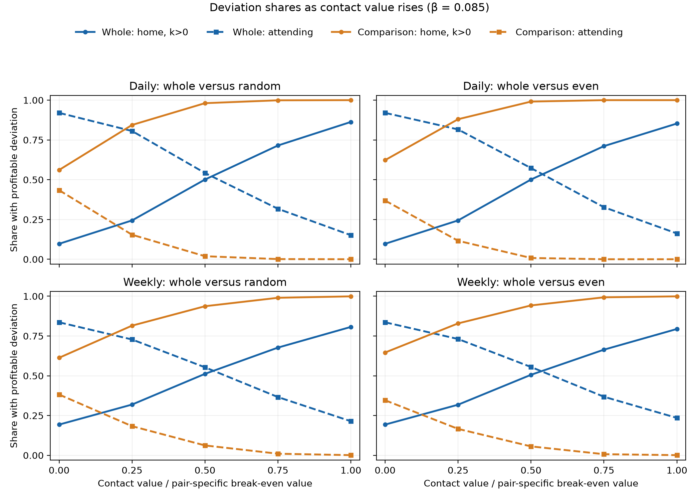

# Report 5 — Deviation curves, network features, and the multiday benchmark

**Communication log:** Follow-up requests, PDF pp. 24–25. This report is prepared for the next reply.

## Deviations from zero contact value to welfare break-even

Source: [saved β = 0.085 archive](../network_sis/data/beta0085_20w50r.npz); 20 worlds, 50 runs per world, 84 days per run. Parameters: β = 0.085, γ = 0.2, `L_day = 10`, `c = 0.05`. Each comparison uses its own welfare break-even value `v*`. The saved infection paths and attendance schedules are held fixed as `v` changes.

Shares are fractions of scheduled person-days. `Home all` counts assigned-home days when attending has a higher private payoff. `Home k>0` uses only assigned-home days with at least one attending neighbor. `Attend` counts assigned-attending days when staying home has a higher private payoff. `Home k=0` is the fraction of assigned-home days with no attending neighbor; it does not change with `v`. A strict payoff improvement counts as a deviation.

### Daily switching: whole versus random (`v* = 0.464765`)

| Split | v/v* | v | Home all | Home k>0 | Attend | Home k=0 |
| --- | ---: | ---: | ---: | ---: | ---: | ---: |
| Whole | 0 | 0.0000 | 0.382 | 0.097 | 0.920 | 0.315 |
| Whole | 0.25 | 0.1162 | 0.482 | 0.244 | 0.806 | 0.315 |
| Whole | 0.50 | 0.2324 | 0.658 | 0.501 | 0.542 | 0.315 |
| Whole | 0.75 | 0.3486 | 0.805 | 0.715 | 0.317 | 0.315 |
| Whole | 1 | 0.4648 | 0.906 | 0.863 | 0.151 | 0.315 |
| Random | 0 | 0.0000 | 0.567 | 0.561 | 0.434 | 0.013 |
| Random | 0.25 | 0.1162 | 0.846 | 0.844 | 0.154 | 0.013 |
| Random | 0.50 | 0.2324 | 0.981 | 0.981 | 0.019 | 0.013 |
| Random | 0.75 | 0.3486 | 0.999 | 0.999 | 0.001 | 0.013 |
| Random | 1 | 0.4648 | 1.000 | 1.000 | 0.000 | 0.013 |

### Daily switching: whole versus even (`v* = 0.456395`)

| Split | v/v* | v | Home all | Home k>0 | Attend | Home k=0 |
| --- | ---: | ---: | ---: | ---: | ---: | ---: |
| Whole | 0 | 0.0000 | 0.382 | 0.097 | 0.920 | 0.315 |
| Whole | 0.25 | 0.1141 | 0.482 | 0.244 | 0.816 | 0.315 |
| Whole | 0.50 | 0.2282 | 0.658 | 0.501 | 0.573 | 0.315 |
| Whole | 0.75 | 0.3423 | 0.802 | 0.711 | 0.327 | 0.315 |
| Whole | 1 | 0.4564 | 0.899 | 0.853 | 0.162 | 0.315 |
| Even | 0 | 0.0000 | 0.627 | 0.623 | 0.369 | 0.011 |
| Even | 0.25 | 0.1141 | 0.882 | 0.880 | 0.116 | 0.011 |
| Even | 0.50 | 0.2282 | 0.991 | 0.991 | 0.008 | 0.011 |
| Even | 0.75 | 0.3423 | 1.000 | 1.000 | 0.000 | 0.011 |
| Even | 1 | 0.4564 | 1.000 | 1.000 | 0.000 | 0.011 |

### Weekly switching: whole versus random (`v* = 0.370548`)

| Split | v/v* | v | Home all | Home k>0 | Attend | Home k=0 |
| --- | ---: | ---: | ---: | ---: | ---: | ---: |
| Whole | 0 | 0.0000 | 0.448 | 0.193 | 0.836 | 0.315 |
| Whole | 0.25 | 0.0926 | 0.534 | 0.319 | 0.728 | 0.315 |
| Whole | 0.50 | 0.1853 | 0.666 | 0.512 | 0.553 | 0.315 |
| Whole | 0.75 | 0.2779 | 0.779 | 0.677 | 0.366 | 0.315 |
| Whole | 1 | 0.3705 | 0.868 | 0.807 | 0.214 | 0.315 |
| Random | 0 | 0.0000 | 0.618 | 0.613 | 0.382 | 0.013 |
| Random | 0.25 | 0.0926 | 0.817 | 0.815 | 0.183 | 0.013 |
| Random | 0.50 | 0.1853 | 0.938 | 0.937 | 0.062 | 0.013 |
| Random | 0.75 | 0.2779 | 0.990 | 0.990 | 0.010 | 0.013 |
| Random | 1 | 0.3705 | 0.999 | 0.999 | 0.001 | 0.013 |

### Weekly switching: whole versus even (`v* = 0.358165`)

| Split | v/v* | v | Home all | Home k>0 | Attend | Home k=0 |
| --- | ---: | ---: | ---: | ---: | ---: | ---: |
| Whole | 0 | 0.0000 | 0.448 | 0.193 | 0.836 | 0.315 |
| Whole | 0.25 | 0.0895 | 0.533 | 0.318 | 0.731 | 0.315 |
| Whole | 0.50 | 0.1791 | 0.662 | 0.506 | 0.555 | 0.315 |
| Whole | 0.75 | 0.2686 | 0.770 | 0.664 | 0.368 | 0.315 |
| Whole | 1 | 0.3582 | 0.859 | 0.794 | 0.235 | 0.315 |
| Even | 0 | 0.0000 | 0.650 | 0.646 | 0.346 | 0.011 |
| Even | 0.25 | 0.0895 | 0.831 | 0.829 | 0.166 | 0.011 |
| Even | 0.50 | 0.1791 | 0.943 | 0.942 | 0.056 | 0.011 |
| Even | 0.75 | 0.2686 | 0.993 | 0.993 | 0.007 | 0.011 |
| Even | 1 | 0.3582 | 0.999 | 0.999 | 0.001 | 0.011 |

At `v=0`, `c=0.05` already produces home-day deviations. Across all four comparisons, raising `v` to break-even adds 60.1–76.6 percentage points to the whole split's home-day deviation share conditional on `k>0`. These shares evaluate unilateral incentives against the saved, fully followed schedules; they do not simulate the altered epidemic after a deviation.

### Figure



The lines connect five sampled values; they are not fitted curves. The x-axis scales `v` by the break-even value of each panel's comparison. Solid lines show assigned-home days with `k>0` whose private payoff favors attending; dashed lines show assigned-attending days whose private payoff favors staying home. The reproduction command also generates a PDF.

Regenerate the figure from the tables above with:

```sh
.venv/bin/python network_sis/plot_obedience_v_curves.py --output-dir "$(mktemp -d)"
```

### Reproduce the tables

From the repository root, run the following command. It reads the saved archive and prints the five sampled points for all four comparisons.

```sh
MPLCONFIGDIR=/private/tmp/mpl-community-check PYTHONPATH=.:network_sis .venv/bin/python - <<'PY'
import numpy as np
from network_sis.community_obedience import (
    collect_all_world_thresholds,
    deviation_counts_from_thresholds,
    welfare_break_even_v,
)

fractions = (0, 0.25, 0.5, 0.75, 1)
with np.load('network_sis/data/beta0085_20w50r.npz', allow_pickle=False) as data:
    for switch_days in (1, 7):
        for comparison in ('random', 'even'):
            v_star = welfare_break_even_v(
                data, 'whole', comparison, switch_days, L_day=10,
            )
            print(f'whole–{comparison}, switch={switch_days}, v*={v_star:.6f}')
            for split_name in ('whole', comparison):
                thresholds = collect_all_world_thresholds(
                    data, split_name, switch_days, L_day=10, c=0.05,
                )
                for fraction in fractions:
                    v = fraction * v_star
                    counts = deviation_counts_from_thresholds(thresholds, v)
                    home_all = counts['home_deviations'] / counts['home_slots']
                    home_positive = (
                        counts['home_positive_deviations']
                        / counts['home_positive_slots']
                    )
                    attend = counts['attend_deviations'] / counts['attend_slots']
                    home_zero = counts['home_zero_slots'] / counts['home_slots']
                    print(
                        f'{split_name:6s} {fraction:.2f} {v:.4f} '
                        f'{home_all:.3f} {home_positive:.3f} '
                        f'{attend:.3f} {home_zero:.3f}'
                    )
PY
```

## Network features and recommendation gains

Data: the 139 connected graph-atlas networks with 4–6 people, from [the atlas CSV](../game/atlas_contact_value_4_6.csv) at π = 0.1 and c = 0.05 or 0.12. The one-day game uses β = 0.04, L_day = 10, γ = 0.2, and contact value v = 0.14. CE gain is best-pure-Nash group cost minus best-CE group cost; a gain greater than 1e-9 counts as an improvement. Mean CE gain averages over every network in a row, including zero gains.

The graph atlas is an enumeration of network structures, not a random sample. Shares below are descriptive; no causal or sampling inference is claimed.

### Feature tables at c = 0.05

#### Pure Nash count, all 139 networks

| Pure Nash count | Networks | CE improves | Share | Mean CE gain |
| ---: | ---: | ---: | ---: | ---: |
| 1 | 29 | 4 | 0.138 | 0.001460 |
| 2 | 49 | 18 | 0.367 | 0.007337 |
| 3 | 25 | 17 | 0.680 | 0.013128 |
| 4 | 15 | 7 | 0.467 | 0.010655 |
| 5 | 9 | 8 | 0.889 | 0.025111 |
| 6 | 6 | 6 | 1.000 | 0.022765 |
| 7 | 4 | 3 | 0.750 | 0.020516 |
| 10 | 1 | 1 | 1.000 | 0.020613 |
| 15 | 1 | 1 | 1.000 | 0.021024 |

#### Edges, all 139 networks

| Edges | Networks | CE improves | Share | Mean CE gain |
| ---: | ---: | ---: | ---: | ---: |
| 3 | 2 | 1 | 0.500 | 0.008912 |
| 4 | 5 | 0 | 0.000 | 0.000000 |
| 5 | 12 | 4 | 0.333 | 0.007285 |
| 6 | 19 | 10 | 0.526 | 0.010085 |
| 7 | 23 | 11 | 0.478 | 0.008954 |
| 8 | 24 | 12 | 0.500 | 0.009197 |
| 9 | 21 | 9 | 0.429 | 0.010124 |
| 10 | 15 | 9 | 0.600 | 0.014052 |
| 11 | 9 | 5 | 0.556 | 0.016266 |
| 12 | 5 | 2 | 0.400 | 0.008693 |
| 13 | 2 | 1 | 0.500 | 0.009166 |
| 14 | 1 | 0 | 0.000 | 0.000000 |
| 15 | 1 | 1 | 1.000 | 0.021024 |

#### Edges, by network size

| People | Edges | Networks | CE improves | Share | Mean CE gain |
| ---: | ---: | ---: | ---: | ---: | ---: |
| 4 | 3 | 2 | 1 | 0.500 | 0.008912 |
| 4 | 4 | 2 | 0 | 0.000 | 0.000000 |
| 4 | 5 | 1 | 0 | 0.000 | 0.000000 |
| 4 | 6 | 1 | 1 | 1.000 | 0.019837 |
| 5 | 4 | 3 | 0 | 0.000 | 0.000000 |
| 5 | 5 | 5 | 2 | 0.400 | 0.009565 |
| 5 | 6 | 5 | 3 | 0.600 | 0.012676 |
| 5 | 7 | 4 | 2 | 0.500 | 0.009332 |
| 5 | 8 | 2 | 1 | 0.500 | 0.009166 |
| 5 | 9 | 1 | 0 | 0.000 | 0.000000 |
| 5 | 10 | 1 | 1 | 1.000 | 0.020613 |
| 6 | 5 | 6 | 2 | 0.333 | 0.006598 |
| 6 | 6 | 13 | 6 | 0.462 | 0.008339 |
| 6 | 7 | 19 | 9 | 0.474 | 0.008875 |
| 6 | 8 | 22 | 11 | 0.500 | 0.009200 |
| 6 | 9 | 20 | 9 | 0.450 | 0.010630 |
| 6 | 10 | 14 | 8 | 0.571 | 0.013583 |
| 6 | 11 | 9 | 5 | 0.556 | 0.016266 |
| 6 | 12 | 5 | 2 | 0.400 | 0.008693 |
| 6 | 13 | 2 | 1 | 0.500 | 0.009166 |
| 6 | 14 | 1 | 0 | 0.000 | 0.000000 |
| 6 | 15 | 1 | 1 | 1.000 | 0.021024 |

#### Triangles, by network size

| People | Triangles | Networks | CE improves | Share | Mean CE gain |
| ---: | ---: | ---: | ---: | ---: | ---: |
| 4 | 0 | 3 | 1 | 0.333 | 0.005942 |
| 4 | 1 | 1 | 0 | 0.000 | 0.000000 |
| 4 | 2 | 1 | 0 | 0.000 | 0.000000 |
| 4 | 4 | 1 | 1 | 1.000 | 0.019837 |
| 5 | 0 | 6 | 1 | 0.167 | 0.005000 |
| 5 | 1 | 4 | 2 | 0.500 | 0.010185 |
| 5 | 2 | 4 | 2 | 0.500 | 0.010115 |
| 5 | 3 | 2 | 1 | 0.500 | 0.009752 |
| 5 | 4 | 2 | 1 | 0.500 | 0.008912 |
| 5 | 5 | 1 | 1 | 1.000 | 0.018331 |
| 5 | 7 | 1 | 0 | 0.000 | 0.000000 |
| 5 | 10 | 1 | 1 | 1.000 | 0.020613 |
| 6 | 0 | 19 | 5 | 0.263 | 0.005271 |
| 6 | 1 | 14 | 8 | 0.571 | 0.009038 |
| 6 | 2 | 21 | 11 | 0.524 | 0.011712 |
| 6 | 3 | 12 | 6 | 0.500 | 0.009529 |
| 6 | 4 | 14 | 6 | 0.429 | 0.009093 |
| 6 | 5 | 8 | 5 | 0.625 | 0.016088 |
| 6 | 6 | 7 | 4 | 0.571 | 0.012392 |
| 6 | 7 | 4 | 2 | 0.500 | 0.011630 |
| 6 | 8 | 4 | 2 | 0.500 | 0.018025 |
| 6 | 9 | 1 | 0 | 0.000 | 0.000000 |
| 6 | 10 | 3 | 2 | 0.667 | 0.015160 |
| 6 | 11 | 1 | 1 | 1.000 | 0.017825 |
| 6 | 12 | 1 | 0 | 0.000 | 0.000000 |
| 6 | 13 | 1 | 1 | 1.000 | 0.018331 |
| 6 | 16 | 1 | 0 | 0.000 | 0.000000 |
| 6 | 20 | 1 | 1 | 1.000 | 0.021024 |

#### Maximum degree, by network size

| People | Maximum degree | Networks | CE improves | Share | Mean CE gain |
| ---: | ---: | ---: | ---: | ---: | ---: |
| 4 | 2 | 2 | 1 | 0.500 | 0.008912 |
| 4 | 3 | 4 | 1 | 0.250 | 0.004959 |
| 5 | 2 | 2 | 1 | 0.500 | 0.015000 |
| 5 | 3 | 8 | 3 | 0.375 | 0.007832 |
| 5 | 4 | 11 | 5 | 0.455 | 0.008620 |
| 6 | 2 | 2 | 1 | 0.500 | 0.011181 |
| 6 | 3 | 27 | 14 | 0.519 | 0.011132 |
| 6 | 4 | 49 | 24 | 0.490 | 0.010107 |
| 6 | 5 | 34 | 15 | 0.441 | 0.009788 |

#### Largest independent set α, by network size

| People | Largest independent set α | Networks | CE improves | Share | Mean CE gain |
| ---: | ---: | ---: | ---: | ---: | ---: |
| 4 | 1 | 1 | 1 | 1.000 | 0.019837 |
| 4 | 2 | 4 | 1 | 0.250 | 0.004456 |
| 4 | 3 | 1 | 0 | 0.000 | 0.000000 |
| 5 | 1 | 1 | 1 | 1.000 | 0.020613 |
| 5 | 2 | 11 | 8 | 0.727 | 0.015169 |
| 5 | 3 | 8 | 0 | 0.000 | 0.000000 |
| 5 | 4 | 1 | 0 | 0.000 | 0.000000 |
| 6 | 1 | 1 | 1 | 1.000 | 0.021024 |
| 6 | 2 | 34 | 27 | 0.794 | 0.020798 |
| 6 | 3 | 63 | 26 | 0.413 | 0.006712 |
| 6 | 4 | 13 | 0 | 0.000 | 0.000000 |
| 6 | 5 | 1 | 0 | 0.000 | 0.000000 |

### Largest independent set within equilibrium groups

| People | Pure Nash | α group | Networks | CE improves | Share |
| ---: | --- | --- | ---: | ---: | ---: |
| 5 | One | ≤2 | 1 | 1 | 1.000 |
| 5 | One | ≥3 | 5 | 0 | 0.000 |
| 5 | Multiple | ≤2 | 11 | 8 | 0.727 |
| 5 | Multiple | ≥3 | 4 | 0 | 0.000 |
| 6 | One | ≤2 | 0 | 0 | — |
| 6 | One | ≥3 | 21 | 3 | 0.143 |
| 6 | Multiple | ≤2 | 35 | 28 | 0.800 |
| 6 | Multiple | ≥3 | 56 | 23 | 0.411 |

### Largest independent set at the same edge count

Six-person networks with multiple pure Nash equilibria; only edge counts where both α groups occur are shown.

| Edges | α ≤ 2: CE gains / networks | α ≥ 3: CE gains / networks |
| ---: | ---: | ---: |
| 7 | 1/1 | 8/14 |
| 8 | 4/4 | 5/13 |
| 9 | 7/7 | 1/10 |
| 10 | 7/8 | 1/5 |
| 11 | 5/7 | 0/2 |
| 12 | 2/4 | 0/1 |
| **Total in shared edge strata** | **26/31** | **15/45** |

### Bowtie (atlas 42) by hand

Edges: `[(0, 1), (0, 4), (1, 4), (2, 3), (2, 4), (3, 4)]`. The two triangles share node 4.

The unique pure Nash is `AAAAH` with group cost **0.210000** above the common infection baseline.

| Person | Pure action | Attending neighbors k | Gain from attending |
| ---: | :---: | ---: | ---: |
| 0 | A | 1 | +0.010000 |
| 1 | A | 1 | +0.010000 |
| 2 | A | 1 | +0.010000 |
| 3 | A | 1 | +0.010000 |
| 4 | H | 4 | -0.105692 |

Each attending outer node has one active contact: infection cost 0.18 minus contact benefit 0.14. Node 4 stays home and pays c = 0.05. Hence `4(0.18 − 0.14) + 0.05 = 0.210000`.

The social minimum is **0.150000**, attained by `AHAHH, AHHAH, HAAHH, HAHAH`. Each has two nonadjacent attendees, zero active contacts, and three people home, so group cost is `3c = 0.15`.

In `AHAHH`, the home-assigned people have these unilateral gains from attending:

| Home person | Attending neighbors k | Gain from attending |
| ---: | ---: | ---: |
| 1 | 1 | +0.010000 |
| 3 | 1 | +0.010000 |
| 4 | 2 | -0.029280 |

The two outer home-assigned people want to deviate, so the social minimum profiles are not pure Nash equilibria.

The best correlated equilibrium has expected group cost **0.191455** and improves on the unique pure Nash by **0.018545** (8.8%). The lottery below averages the LP solution over graph automorphisms.

| Profile | Probability | Group cost |
| :--- | ---: | ---: |
| `AHAHA` | 0.074797 | 0.259280 |
| `AHAHH` | 0.131403 | 0.150000 |
| `AHHAA` | 0.074797 | 0.259280 |
| `AHHAH` | 0.131403 | 0.150000 |
| `HAAHA` | 0.074797 | 0.259280 |
| `HAAHH` | 0.131403 | 0.150000 |
| `HAHAA` | 0.074797 | 0.259280 |
| `HAHAH` | 0.131403 | 0.150000 |
| `HHHHA` | 0.175203 | 0.200000 |

| Profile category | Total probability | Cost per profile |
| :--- | ---: | ---: |
| Four social-minimum profiles | 0.525610 | 0.150000 |
| Four profiles with center and two outer nodes attending | 0.299186 | 0.259280 |
| Center alone (`HHHHA`) | 0.175203 | 0.200000 |

Category totals use unrounded probabilities, so they may differ slightly from sums of the displayed profile rows.

| Person | Recommendation | Probability of recommendation | Conditional gain from obeying |
| ---: | :---: | ---: | ---: |
| 0 | A | 0.412398 | +0.03549042 |
| 0 | H | 0.587602 | +0.00000000 |
| 4 | A | 0.474390 | +0.00000000 |
| 4 | H | 0.525610 | +0.02928000 |

The outer-node `H` and center-node `A` obedience constraints bind. The costly profiles make staying home more attractive to an outer node who receives `H`; the center-alone profile offsets the center's temptation to stay home when it receives `A`. These conditional incentives let the CE place positive probability on social-minimum profiles that are not pure Nash equilibria.

### Feature checks at c = 0.12

The same 139 networks and game parameters are used, changing only the cost of staying home from 0.05 to 0.12.

#### Pure Nash count, all 139 networks

| Pure Nash count | Networks | CE improves | Share | Mean CE gain |
| ---: | ---: | ---: | ---: | ---: |
| 1 | 104 | 0 | 0.000 | 0.000000 |
| 2 | 18 | 17 | 0.944 | 0.098018 |
| 3 | 10 | 9 | 0.900 | 0.078146 |
| 4 | 4 | 3 | 0.750 | 0.076427 |
| 5 | 1 | 1 | 1.000 | 0.101288 |
| 7 | 1 | 1 | 1.000 | 0.105410 |
| 15 | 1 | 1 | 1.000 | 0.104095 |

#### Largest independent set among networks with multiple pure Nash

No four-person network has multiple pure Nash at this c.

| People | α | Networks | CE improves | Share | Mean CE gain |
| ---: | ---: | ---: | ---: | ---: | ---: |
| 5 | 1 | 1 | 1 | 1.000 | 0.101288 |
| 5 | 2 | 2 | 2 | 1.000 | 0.103209 |
| 5 | 3 | 1 | 1 | 1.000 | 0.105135 |
| 6 | 1 | 1 | 1 | 1.000 | 0.104095 |
| 6 | 2 | 16 | 14 | 0.875 | 0.080756 |
| 6 | 3 | 13 | 12 | 0.923 | 0.096009 |
| 6 | 4 | 1 | 1 | 1.000 | 0.105135 |

#### Edges among six-person networks with multiple pure Nash

| Edges | Networks | CE improves | Share | Mean CE gain |
| ---: | ---: | ---: | ---: | ---: |
| 7 | 1 | 1 | 1.000 | 0.105135 |
| 8 | 4 | 4 | 1.000 | 0.104161 |
| 9 | 8 | 8 | 1.000 | 0.103109 |
| 10 | 7 | 6 | 0.857 | 0.087717 |
| 11 | 4 | 2 | 0.500 | 0.051723 |
| 12 | 3 | 3 | 1.000 | 0.078410 |
| 13 | 2 | 2 | 1.000 | 0.068574 |
| 14 | 1 | 1 | 1.000 | 0.105410 |
| 15 | 1 | 1 | 1.000 | 0.104095 |

#### Triangles among six-person networks with multiple pure Nash

| Triangles | Networks | CE improves | Share | Mean CE gain |
| ---: | ---: | ---: | ---: | ---: |
| 2 | 2 | 2 | 1.000 | 0.104813 |
| 3 | 5 | 5 | 1.000 | 0.103706 |
| 4 | 7 | 6 | 0.857 | 0.088362 |
| 5 | 4 | 4 | 1.000 | 0.102549 |
| 6 | 4 | 3 | 0.750 | 0.077366 |
| 7 | 2 | 1 | 0.500 | 0.050605 |
| 8 | 1 | 1 | 1.000 | 0.023499 |
| 9 | 1 | 1 | 1.000 | 0.103682 |
| 10 | 1 | 1 | 1.000 | 0.108048 |
| 12 | 1 | 1 | 1.000 | 0.030421 |
| 13 | 1 | 1 | 1.000 | 0.106727 |
| 16 | 1 | 1 | 1.000 | 0.105410 |
| 20 | 1 | 1 | 1.000 | 0.104095 |

#### Maximum degree among six-person networks with multiple pure Nash

| Maximum degree | Networks | CE improves | Share | Mean CE gain |
| ---: | ---: | ---: | ---: | ---: |
| 4 | 24 | 21 | 0.875 | 0.086921 |
| 5 | 7 | 7 | 1.000 | 0.094764 |

#### Multiple-equilibrium networks with no CE gain

| Atlas ID | Pure Nash | Edges | Triangles | Maximum degree | α | Best pure | Best CE | Social minimum | Pure-to-minimum gap |
| ---: | ---: | ---: | ---: | ---: | ---: | ---: | ---: | ---: | ---: |
| 186 | 2 | 10 | 4 | 4 | 3 | 0.399280 | 0.399280 | 0.360000 | 0.039280 |
| 194 | 4 | 11 | 7 | 4 | 2 | 0.477840 | 0.477840 | 0.440000 | 0.037840 |
| 198 | 3 | 11 | 6 | 4 | 2 | 0.478560 | 0.478560 | 0.440000 | 0.038560 |

All three retain a positive gap to the social minimum. The CE constraints prevent an improvement at these parameters.

#### Matched networks at 10–11 edges and maximum degree 4

These six-person networks all have multiple pure Nash.

| Atlas ID | Pure Nash | Edges | Triangles | α | CE gain |
| ---: | ---: | ---: | ---: | ---: | ---: |
| 178 | 4 | 10 | 7 | 2 | 0.101211 |
| 181 | 4 | 10 | 6 | 2 | 0.102570 |
| 184 | 3 | 10 | 5 | 2 | 0.102570 |
| 185 | 3 | 10 | 5 | 2 | 0.101889 |
| 186 | 2 | 10 | 4 | 3 | 0.000000 |
| 188 | 2 | 10 | 4 | 2 | 0.102568 |
| 189 | 2 | 10 | 3 | 3 | 0.103208 |
| 194 | 4 | 11 | 7 | 2 | 0.000000 |
| 198 | 3 | 11 | 6 | 2 | 0.000000 |
| 199 | 4 | 11 | 6 | 2 | 0.101928 |

At c = 0.12, equilibrium multiplicity is the strongest descriptive separator: 0/104 unique-equilibrium networks improve, versus 32/35 with multiple equilibria. Within those 35 networks, α does not separate outcomes as it did at c = 0.05: among six-person networks, 14/16 with α = 2 and 12/13 with α = 3 improve. Edge count and triangle count are not monotone; all three failures have maximum degree 4, but 21/24 networks with that degree still improve. The matched table contains both outcomes at the same network size, edge count, and maximum degree; no individual feature shown is a sufficient rule.

### Findings and limits

The next six findings concern c = 0.05; the c = 0.12 comparisons are reported above.

- CE improves on best pure Nash in **65/139** networks. The gain occurs in **4/29** networks with one pure Nash and **61/110** with multiple pure Nash equilibria; multiplicity is associated with gain but is not necessary.
- Edge count alone is not monotone within network size. For six-person networks, 8/14 with 10 edges improve, while 2/5 with 12 edges improve. Sparse extreme edge-count cells are unstable as descriptive rates.
- Among six-person networks, 5/19 with no triangles improve versus 49/93 with at least one triangle. The share does not rise steadily with triangle count; triangles also covary with density.
- Maximum degree shows little separation among six-person networks: 14/27 at degree 3, 24/49 at degree 4, and 15/34 at degree 5.
- The largest-independent-set size gives the clearest descriptive separation. Among six-person networks with multiple pure Nash equilibria, CE improves in **28/35** with α ≤ 2 versus **23/56** with α ≥ 3. Restricting to edge counts 7–12 where both groups occur gives **26/31** versus **15/45**. This does not isolate α from every other network feature.
- Bowtie shows why one pure Nash does not rule out a CE gain: private recommendations can make a lottery over non-Nash profiles obedient after conditioning on the recommendation.

### Complete feature data at π = 0.10

| c | Atlas ID | People | Edges | Pure Nash count | Triangles | Maximum degree | Largest independent set | CE gain |
|---:|---:|---:|---:|---:|---:|---:|---:|---:|
| 0.05 | 13 | 4 | 3 | 1 | 0 | 3 | 3 | 0.000000 |
| 0.05 | 14 | 4 | 3 | 2 | 0 | 2 | 2 | 0.017825 |
| 0.05 | 15 | 4 | 4 | 1 | 1 | 3 | 2 | 0.000000 |
| 0.05 | 16 | 4 | 4 | 2 | 0 | 2 | 2 | 0.000000 |
| 0.05 | 17 | 4 | 5 | 2 | 2 | 3 | 2 | 0.000000 |
| 0.05 | 18 | 4 | 6 | 6 | 4 | 3 | 1 | 0.019837 |
| 0.05 | 29 | 5 | 4 | 1 | 0 | 4 | 4 | 0.000000 |
| 0.05 | 30 | 5 | 4 | 1 | 0 | 3 | 3 | 0.000000 |
| 0.05 | 31 | 5 | 4 | 2 | 0 | 2 | 3 | 0.000000 |
| 0.05 | 34 | 5 | 5 | 1 | 1 | 4 | 3 | 0.000000 |
| 0.05 | 35 | 5 | 5 | 1 | 1 | 3 | 3 | 0.000000 |
| 0.05 | 36 | 5 | 5 | 3 | 1 | 3 | 2 | 0.017825 |
| 0.05 | 37 | 5 | 5 | 2 | 0 | 3 | 3 | 0.000000 |
| 0.05 | 38 | 5 | 5 | 5 | 0 | 2 | 2 | 0.030000 |
| 0.05 | 40 | 5 | 6 | 1 | 2 | 4 | 3 | 0.000000 |
| 0.05 | 41 | 5 | 6 | 4 | 2 | 3 | 2 | 0.021916 |
| 0.05 | 42 | 5 | 6 | 1 | 2 | 4 | 2 | 0.018545 |
| 0.05 | 43 | 5 | 6 | 3 | 1 | 3 | 2 | 0.022917 |
| 0.05 | 44 | 5 | 6 | 2 | 0 | 3 | 3 | 0.000000 |
| 0.05 | 45 | 5 | 7 | 3 | 4 | 4 | 2 | 0.017825 |
| 0.05 | 46 | 5 | 7 | 2 | 3 | 4 | 3 | 0.000000 |
| 0.05 | 47 | 5 | 7 | 2 | 3 | 4 | 2 | 0.019505 |
| 0.05 | 48 | 5 | 7 | 2 | 2 | 3 | 2 | 0.000000 |
| 0.05 | 49 | 5 | 8 | 2 | 5 | 4 | 2 | 0.018331 |
| 0.05 | 50 | 5 | 8 | 2 | 4 | 4 | 2 | 0.000000 |
| 0.05 | 51 | 5 | 9 | 4 | 7 | 4 | 2 | 0.000000 |
| 0.05 | 52 | 5 | 10 | 10 | 10 | 4 | 1 | 0.020613 |
| 0.05 | 77 | 6 | 5 | 1 | 0 | 5 | 5 | 0.000000 |
| 0.05 | 78 | 6 | 5 | 1 | 0 | 4 | 4 | 0.000000 |
| 0.05 | 79 | 6 | 5 | 1 | 0 | 3 | 4 | 0.000000 |
| 0.05 | 80 | 6 | 5 | 2 | 0 | 3 | 3 | 0.017228 |
| 0.05 | 81 | 6 | 5 | 1 | 0 | 3 | 4 | 0.000000 |
| 0.05 | 83 | 6 | 5 | 3 | 0 | 2 | 3 | 0.022363 |
| 0.05 | 92 | 6 | 6 | 1 | 1 | 5 | 4 | 0.000000 |
| 0.05 | 93 | 6 | 6 | 1 | 1 | 4 | 4 | 0.000000 |
| 0.05 | 94 | 6 | 6 | 3 | 1 | 3 | 3 | 0.019837 |
| 0.05 | 95 | 6 | 6 | 1 | 1 | 4 | 3 | 0.000000 |
| 0.05 | 96 | 6 | 6 | 1 | 0 | 4 | 4 | 0.000000 |
| 0.05 | 97 | 6 | 6 | 2 | 1 | 3 | 3 | 0.017825 |
| 0.05 | 98 | 6 | 6 | 3 | 0 | 3 | 3 | 0.022363 |
| 0.05 | 99 | 6 | 6 | 2 | 0 | 3 | 4 | 0.000000 |
| 0.05 | 100 | 6 | 6 | 3 | 1 | 3 | 3 | 0.017825 |
| 0.05 | 102 | 6 | 6 | 3 | 1 | 3 | 3 | 0.007689 |
| 0.05 | 103 | 6 | 6 | 2 | 0 | 3 | 3 | 0.000000 |
| 0.05 | 104 | 6 | 6 | 3 | 0 | 3 | 3 | 0.022871 |
| 0.05 | 105 | 6 | 6 | 5 | 0 | 2 | 3 | 0.000000 |
| 0.05 | 111 | 6 | 7 | 1 | 2 | 5 | 4 | 0.000000 |
| 0.05 | 112 | 6 | 7 | 1 | 2 | 4 | 4 | 0.000000 |
| 0.05 | 113 | 6 | 7 | 2 | 2 | 4 | 3 | 0.017825 |
| 0.05 | 114 | 6 | 7 | 3 | 2 | 4 | 3 | 0.017825 |
| 0.05 | 115 | 6 | 7 | 2 | 2 | 3 | 3 | 0.013956 |
| 0.05 | 117 | 6 | 7 | 1 | 2 | 5 | 3 | 0.000000 |
| 0.05 | 118 | 6 | 7 | 2 | 1 | 4 | 3 | 0.018133 |
| 0.05 | 119 | 6 | 7 | 1 | 2 | 4 | 3 | 0.000000 |
| 0.05 | 120 | 6 | 7 | 2 | 2 | 4 | 3 | 0.015327 |
| 0.05 | 121 | 6 | 7 | 2 | 0 | 4 | 4 | 0.000000 |
| 0.05 | 122 | 6 | 7 | 2 | 1 | 3 | 3 | 0.015869 |
| 0.05 | 123 | 6 | 7 | 4 | 2 | 3 | 3 | 0.000000 |
| 0.05 | 124 | 6 | 7 | 3 | 1 | 3 | 3 | 0.000000 |
| 0.05 | 125 | 6 | 7 | 2 | 0 | 3 | 3 | 0.000000 |
| 0.05 | 126 | 6 | 7 | 3 | 1 | 4 | 3 | 0.009633 |
| 0.05 | 127 | 6 | 7 | 4 | 1 | 3 | 3 | 0.000000 |
| 0.05 | 128 | 6 | 7 | 3 | 0 | 3 | 3 | 0.000000 |
| 0.05 | 129 | 6 | 7 | 3 | 0 | 3 | 3 | 0.015327 |
| 0.05 | 130 | 6 | 7 | 5 | 2 | 3 | 2 | 0.044725 |
| 0.05 | 133 | 6 | 8 | 3 | 4 | 5 | 3 | 0.017825 |
| 0.05 | 134 | 6 | 8 | 1 | 4 | 4 | 3 | 0.000000 |
| 0.05 | 135 | 6 | 8 | 1 | 3 | 5 | 4 | 0.000000 |
| 0.05 | 136 | 6 | 8 | 2 | 3 | 5 | 3 | 0.017825 |
| 0.05 | 137 | 6 | 8 | 1 | 3 | 4 | 3 | 0.002681 |
| 0.05 | 138 | 6 | 8 | 2 | 3 | 4 | 3 | 0.019723 |
| 0.05 | 139 | 6 | 8 | 3 | 3 | 4 | 3 | 0.000000 |
| 0.05 | 140 | 6 | 8 | 2 | 2 | 4 | 3 | 0.000000 |
| 0.05 | 141 | 6 | 8 | 2 | 2 | 4 | 3 | 0.018331 |
| 0.05 | 142 | 6 | 8 | 6 | 4 | 4 | 2 | 0.019837 |
| 0.05 | 143 | 6 | 8 | 2 | 2 | 3 | 3 | 0.000000 |
| 0.05 | 144 | 6 | 8 | 1 | 3 | 5 | 3 | 0.000000 |
| 0.05 | 145 | 6 | 8 | 1 | 2 | 4 | 3 | 0.010188 |
| 0.05 | 146 | 6 | 8 | 2 | 0 | 4 | 4 | 0.000000 |
| 0.05 | 147 | 6 | 8 | 4 | 2 | 4 | 3 | 0.000000 |
| 0.05 | 148 | 6 | 8 | 2 | 2 | 4 | 3 | 0.000000 |
| 0.05 | 149 | 6 | 8 | 2 | 1 | 4 | 3 | 0.019723 |
| 0.05 | 150 | 6 | 8 | 5 | 3 | 4 | 2 | 0.021203 |
| 0.05 | 151 | 6 | 8 | 4 | 1 | 3 | 3 | 0.000000 |
| 0.05 | 152 | 6 | 8 | 4 | 2 | 3 | 2 | 0.025059 |
| 0.05 | 153 | 6 | 8 | 7 | 2 | 3 | 2 | 0.030000 |
| 0.05 | 154 | 6 | 8 | 2 | 0 | 3 | 3 | 0.000000 |
| 0.05 | 156 | 6 | 9 | 1 | 5 | 5 | 3 | 0.000000 |
| 0.05 | 157 | 6 | 9 | 2 | 5 | 4 | 3 | 0.000000 |
| 0.05 | 158 | 6 | 9 | 2 | 4 | 5 | 3 | 0.000000 |
| 0.05 | 159 | 6 | 9 | 3 | 4 | 4 | 3 | 0.000000 |
| 0.05 | 160 | 6 | 9 | 6 | 5 | 4 | 2 | 0.019837 |
| 0.05 | 161 | 6 | 9 | 2 | 4 | 5 | 4 | 0.000000 |
| 0.05 | 162 | 6 | 9 | 1 | 4 | 5 | 3 | 0.010925 |
| 0.05 | 163 | 6 | 9 | 1 | 4 | 4 | 3 | 0.000000 |
| 0.05 | 164 | 6 | 9 | 2 | 4 | 5 | 3 | 0.000000 |
| 0.05 | 165 | 6 | 9 | 3 | 5 | 5 | 2 | 0.027505 |
| 0.05 | 166 | 6 | 9 | 2 | 3 | 4 | 3 | 0.000000 |
| 0.05 | 167 | 6 | 9 | 5 | 4 | 4 | 2 | 0.026348 |
| 0.05 | 168 | 6 | 9 | 4 | 3 | 4 | 3 | 0.000000 |
| 0.05 | 169 | 6 | 9 | 5 | 4 | 4 | 2 | 0.022363 |
| 0.05 | 170 | 6 | 9 | 2 | 2 | 4 | 3 | 0.022707 |
| 0.05 | 171 | 6 | 9 | 7 | 3 | 4 | 2 | 0.030000 |
| 0.05 | 172 | 6 | 9 | 4 | 3 | 4 | 2 | 0.022917 |
| 0.05 | 173 | 6 | 9 | 3 | 2 | 4 | 3 | 0.000000 |
| 0.05 | 174 | 6 | 9 | 6 | 2 | 3 | 2 | 0.030000 |
| 0.05 | 175 | 6 | 9 | 2 | 0 | 3 | 3 | 0.000000 |
| 0.05 | 177 | 6 | 10 | 2 | 7 | 5 | 3 | 0.000000 |
| 0.05 | 178 | 6 | 10 | 7 | 7 | 4 | 2 | 0.022063 |
| 0.05 | 179 | 6 | 10 | 2 | 6 | 5 | 3 | 0.011039 |
| 0.05 | 180 | 6 | 10 | 1 | 6 | 5 | 3 | 0.000000 |
| 0.05 | 181 | 6 | 10 | 6 | 6 | 4 | 2 | 0.027241 |
| 0.05 | 182 | 6 | 10 | 2 | 5 | 5 | 3 | 0.000000 |
| 0.05 | 183 | 6 | 10 | 3 | 6 | 5 | 2 | 0.018463 |
| 0.05 | 184 | 6 | 10 | 5 | 5 | 4 | 2 | 0.022917 |
| 0.05 | 185 | 6 | 10 | 5 | 5 | 4 | 2 | 0.028444 |
| 0.05 | 186 | 6 | 10 | 2 | 4 | 4 | 3 | 0.000000 |
| 0.05 | 187 | 6 | 10 | 5 | 5 | 5 | 2 | 0.030000 |
| 0.05 | 188 | 6 | 10 | 4 | 4 | 4 | 2 | 0.030000 |
| 0.05 | 189 | 6 | 10 | 2 | 3 | 4 | 3 | 0.000000 |
| 0.05 | 190 | 6 | 10 | 2 | 4 | 4 | 2 | 0.000000 |
| 0.05 | 191 | 6 | 11 | 6 | 10 | 5 | 2 | 0.019837 |
| 0.05 | 192 | 6 | 11 | 2 | 8 | 5 | 3 | 0.000000 |
| 0.05 | 193 | 6 | 11 | 4 | 8 | 5 | 2 | 0.023770 |
| 0.05 | 194 | 6 | 11 | 4 | 7 | 4 | 2 | 0.000000 |
| 0.05 | 195 | 6 | 11 | 2 | 8 | 5 | 2 | 0.048331 |
| 0.05 | 196 | 6 | 11 | 3 | 7 | 5 | 2 | 0.024456 |
| 0.05 | 197 | 6 | 11 | 2 | 6 | 5 | 3 | 0.000000 |
| 0.05 | 198 | 6 | 11 | 3 | 6 | 4 | 2 | 0.000000 |
| 0.05 | 199 | 6 | 11 | 2 | 6 | 4 | 2 | 0.030000 |
| 0.05 | 200 | 6 | 12 | 4 | 11 | 5 | 2 | 0.017825 |
| 0.05 | 201 | 6 | 12 | 4 | 10 | 5 | 3 | 0.000000 |
| 0.05 | 202 | 6 | 12 | 3 | 10 | 5 | 2 | 0.025642 |
| 0.05 | 203 | 6 | 12 | 2 | 9 | 5 | 2 | 0.000000 |
| 0.05 | 204 | 6 | 12 | 3 | 8 | 4 | 2 | 0.000000 |
| 0.05 | 205 | 6 | 13 | 4 | 13 | 5 | 2 | 0.018331 |
| 0.05 | 206 | 6 | 13 | 3 | 12 | 5 | 2 | 0.000000 |
| 0.05 | 207 | 6 | 14 | 7 | 16 | 5 | 2 | 0.000000 |
| 0.05 | 208 | 6 | 15 | 15 | 20 | 5 | 1 | 0.021024 |
| 0.12 | 13 | 4 | 3 | 1 | 0 | 3 | 3 | 0.000000 |
| 0.12 | 14 | 4 | 3 | 1 | 0 | 2 | 2 | 0.000000 |
| 0.12 | 15 | 4 | 4 | 1 | 1 | 3 | 2 | 0.000000 |
| 0.12 | 16 | 4 | 4 | 1 | 0 | 2 | 2 | 0.000000 |
| 0.12 | 17 | 4 | 5 | 1 | 2 | 3 | 2 | 0.000000 |
| 0.12 | 18 | 4 | 6 | 1 | 4 | 3 | 1 | 0.000000 |
| 0.12 | 29 | 5 | 4 | 1 | 0 | 4 | 4 | 0.000000 |
| 0.12 | 30 | 5 | 4 | 1 | 0 | 3 | 3 | 0.000000 |
| 0.12 | 31 | 5 | 4 | 1 | 0 | 2 | 3 | 0.000000 |
| 0.12 | 34 | 5 | 5 | 1 | 1 | 4 | 3 | 0.000000 |
| 0.12 | 35 | 5 | 5 | 1 | 1 | 3 | 3 | 0.000000 |
| 0.12 | 36 | 5 | 5 | 1 | 1 | 3 | 2 | 0.000000 |
| 0.12 | 37 | 5 | 5 | 1 | 0 | 3 | 3 | 0.000000 |
| 0.12 | 38 | 5 | 5 | 1 | 0 | 2 | 2 | 0.000000 |
| 0.12 | 40 | 5 | 6 | 1 | 2 | 4 | 3 | 0.000000 |
| 0.12 | 41 | 5 | 6 | 1 | 2 | 3 | 2 | 0.000000 |
| 0.12 | 42 | 5 | 6 | 1 | 2 | 4 | 2 | 0.000000 |
| 0.12 | 43 | 5 | 6 | 1 | 1 | 3 | 2 | 0.000000 |
| 0.12 | 44 | 5 | 6 | 1 | 0 | 3 | 3 | 0.000000 |
| 0.12 | 45 | 5 | 7 | 1 | 4 | 4 | 2 | 0.000000 |
| 0.12 | 46 | 5 | 7 | 2 | 3 | 4 | 3 | 0.105135 |
| 0.12 | 47 | 5 | 7 | 1 | 3 | 4 | 2 | 0.000000 |
| 0.12 | 48 | 5 | 7 | 1 | 2 | 3 | 2 | 0.000000 |
| 0.12 | 49 | 5 | 8 | 2 | 5 | 4 | 2 | 0.103850 |
| 0.12 | 50 | 5 | 8 | 1 | 4 | 4 | 2 | 0.000000 |
| 0.12 | 51 | 5 | 9 | 3 | 7 | 4 | 2 | 0.102568 |
| 0.12 | 52 | 5 | 10 | 5 | 10 | 4 | 1 | 0.101288 |
| 0.12 | 77 | 6 | 5 | 1 | 0 | 5 | 5 | 0.000000 |
| 0.12 | 78 | 6 | 5 | 1 | 0 | 4 | 4 | 0.000000 |
| 0.12 | 79 | 6 | 5 | 1 | 0 | 3 | 4 | 0.000000 |
| 0.12 | 80 | 6 | 5 | 1 | 0 | 3 | 3 | 0.000000 |
| 0.12 | 81 | 6 | 5 | 1 | 0 | 3 | 4 | 0.000000 |
| 0.12 | 83 | 6 | 5 | 1 | 0 | 2 | 3 | 0.000000 |
| 0.12 | 92 | 6 | 6 | 1 | 1 | 5 | 4 | 0.000000 |
| 0.12 | 93 | 6 | 6 | 1 | 1 | 4 | 4 | 0.000000 |
| 0.12 | 94 | 6 | 6 | 1 | 1 | 3 | 3 | 0.000000 |
| 0.12 | 95 | 6 | 6 | 1 | 1 | 4 | 3 | 0.000000 |
| 0.12 | 96 | 6 | 6 | 1 | 0 | 4 | 4 | 0.000000 |
| 0.12 | 97 | 6 | 6 | 1 | 1 | 3 | 3 | 0.000000 |
| 0.12 | 98 | 6 | 6 | 1 | 0 | 3 | 3 | 0.000000 |
| 0.12 | 99 | 6 | 6 | 1 | 0 | 3 | 4 | 0.000000 |
| 0.12 | 100 | 6 | 6 | 1 | 1 | 3 | 3 | 0.000000 |
| 0.12 | 102 | 6 | 6 | 1 | 1 | 3 | 3 | 0.000000 |
| 0.12 | 103 | 6 | 6 | 1 | 0 | 3 | 3 | 0.000000 |
| 0.12 | 104 | 6 | 6 | 1 | 0 | 3 | 3 | 0.000000 |
| 0.12 | 105 | 6 | 6 | 1 | 0 | 2 | 3 | 0.000000 |
| 0.12 | 111 | 6 | 7 | 1 | 2 | 5 | 4 | 0.000000 |
| 0.12 | 112 | 6 | 7 | 2 | 2 | 4 | 4 | 0.105135 |
| 0.12 | 113 | 6 | 7 | 1 | 2 | 4 | 3 | 0.000000 |
| 0.12 | 114 | 6 | 7 | 1 | 2 | 4 | 3 | 0.000000 |
| 0.12 | 115 | 6 | 7 | 1 | 2 | 3 | 3 | 0.000000 |
| 0.12 | 117 | 6 | 7 | 1 | 2 | 5 | 3 | 0.000000 |
| 0.12 | 118 | 6 | 7 | 1 | 1 | 4 | 3 | 0.000000 |
| 0.12 | 119 | 6 | 7 | 1 | 2 | 4 | 3 | 0.000000 |
| 0.12 | 120 | 6 | 7 | 1 | 2 | 4 | 3 | 0.000000 |
| 0.12 | 121 | 6 | 7 | 1 | 0 | 4 | 4 | 0.000000 |
| 0.12 | 122 | 6 | 7 | 1 | 1 | 3 | 3 | 0.000000 |
| 0.12 | 123 | 6 | 7 | 1 | 2 | 3 | 3 | 0.000000 |
| 0.12 | 124 | 6 | 7 | 1 | 1 | 3 | 3 | 0.000000 |
| 0.12 | 125 | 6 | 7 | 1 | 0 | 3 | 3 | 0.000000 |
| 0.12 | 126 | 6 | 7 | 1 | 1 | 4 | 3 | 0.000000 |
| 0.12 | 127 | 6 | 7 | 1 | 1 | 3 | 3 | 0.000000 |
| 0.12 | 128 | 6 | 7 | 1 | 0 | 3 | 3 | 0.000000 |
| 0.12 | 129 | 6 | 7 | 1 | 0 | 3 | 3 | 0.000000 |
| 0.12 | 130 | 6 | 7 | 1 | 2 | 3 | 2 | 0.000000 |
| 0.12 | 133 | 6 | 8 | 1 | 4 | 5 | 3 | 0.000000 |
| 0.12 | 134 | 6 | 8 | 2 | 4 | 4 | 3 | 0.103850 |
| 0.12 | 135 | 6 | 8 | 1 | 3 | 5 | 4 | 0.000000 |
| 0.12 | 136 | 6 | 8 | 1 | 3 | 5 | 3 | 0.000000 |
| 0.12 | 137 | 6 | 8 | 2 | 3 | 4 | 3 | 0.103811 |
| 0.12 | 138 | 6 | 8 | 2 | 3 | 4 | 3 | 0.104492 |
| 0.12 | 139 | 6 | 8 | 1 | 3 | 4 | 3 | 0.000000 |
| 0.12 | 140 | 6 | 8 | 1 | 2 | 4 | 3 | 0.000000 |
| 0.12 | 141 | 6 | 8 | 1 | 2 | 4 | 3 | 0.000000 |
| 0.12 | 142 | 6 | 8 | 1 | 4 | 4 | 2 | 0.000000 |
| 0.12 | 143 | 6 | 8 | 1 | 2 | 3 | 3 | 0.000000 |
| 0.12 | 144 | 6 | 8 | 1 | 3 | 5 | 3 | 0.000000 |
| 0.12 | 145 | 6 | 8 | 2 | 2 | 4 | 3 | 0.104492 |
| 0.12 | 146 | 6 | 8 | 1 | 0 | 4 | 4 | 0.000000 |
| 0.12 | 147 | 6 | 8 | 1 | 2 | 4 | 3 | 0.000000 |
| 0.12 | 148 | 6 | 8 | 1 | 2 | 4 | 3 | 0.000000 |
| 0.12 | 149 | 6 | 8 | 1 | 1 | 4 | 3 | 0.000000 |
| 0.12 | 150 | 6 | 8 | 1 | 3 | 4 | 2 | 0.000000 |
| 0.12 | 151 | 6 | 8 | 1 | 1 | 3 | 3 | 0.000000 |
| 0.12 | 152 | 6 | 8 | 1 | 2 | 3 | 2 | 0.000000 |
| 0.12 | 153 | 6 | 8 | 1 | 2 | 3 | 2 | 0.000000 |
| 0.12 | 154 | 6 | 8 | 1 | 0 | 3 | 3 | 0.000000 |
| 0.12 | 156 | 6 | 9 | 1 | 5 | 5 | 3 | 0.000000 |
| 0.12 | 157 | 6 | 9 | 3 | 5 | 4 | 3 | 0.102529 |
| 0.12 | 158 | 6 | 9 | 1 | 4 | 5 | 3 | 0.000000 |
| 0.12 | 159 | 6 | 9 | 2 | 4 | 4 | 3 | 0.102490 |
| 0.12 | 160 | 6 | 9 | 2 | 5 | 4 | 2 | 0.103208 |
| 0.12 | 161 | 6 | 9 | 1 | 4 | 5 | 4 | 0.000000 |
| 0.12 | 162 | 6 | 9 | 1 | 4 | 5 | 3 | 0.000000 |
| 0.12 | 163 | 6 | 9 | 3 | 4 | 4 | 3 | 0.103210 |
| 0.12 | 164 | 6 | 9 | 1 | 4 | 5 | 3 | 0.000000 |
| 0.12 | 165 | 6 | 9 | 1 | 5 | 5 | 2 | 0.000000 |
| 0.12 | 166 | 6 | 9 | 2 | 3 | 4 | 3 | 0.103171 |
| 0.12 | 167 | 6 | 9 | 2 | 4 | 4 | 2 | 0.103208 |
| 0.12 | 168 | 6 | 9 | 2 | 3 | 4 | 3 | 0.103850 |
| 0.12 | 169 | 6 | 9 | 2 | 4 | 4 | 2 | 0.103208 |
| 0.12 | 170 | 6 | 9 | 1 | 2 | 4 | 3 | 0.000000 |
| 0.12 | 171 | 6 | 9 | 1 | 3 | 4 | 2 | 0.000000 |
| 0.12 | 172 | 6 | 9 | 1 | 3 | 4 | 2 | 0.000000 |
| 0.12 | 173 | 6 | 9 | 1 | 2 | 4 | 3 | 0.000000 |
| 0.12 | 174 | 6 | 9 | 1 | 2 | 3 | 2 | 0.000000 |
| 0.12 | 175 | 6 | 9 | 1 | 0 | 3 | 3 | 0.000000 |
| 0.12 | 177 | 6 | 10 | 1 | 7 | 5 | 3 | 0.000000 |
| 0.12 | 178 | 6 | 10 | 4 | 7 | 4 | 2 | 0.101211 |
| 0.12 | 179 | 6 | 10 | 1 | 6 | 5 | 3 | 0.000000 |
| 0.12 | 180 | 6 | 10 | 1 | 6 | 5 | 3 | 0.000000 |
| 0.12 | 181 | 6 | 10 | 4 | 6 | 4 | 2 | 0.102570 |
| 0.12 | 182 | 6 | 10 | 1 | 5 | 5 | 3 | 0.000000 |
| 0.12 | 183 | 6 | 10 | 1 | 6 | 5 | 2 | 0.000000 |
| 0.12 | 184 | 6 | 10 | 3 | 5 | 4 | 2 | 0.102570 |
| 0.12 | 185 | 6 | 10 | 3 | 5 | 4 | 2 | 0.101889 |
| 0.12 | 186 | 6 | 10 | 2 | 4 | 4 | 3 | 0.000000 |
| 0.12 | 187 | 6 | 10 | 1 | 5 | 5 | 2 | 0.000000 |
| 0.12 | 188 | 6 | 10 | 2 | 4 | 4 | 2 | 0.102568 |
| 0.12 | 189 | 6 | 10 | 2 | 3 | 4 | 3 | 0.103208 |
| 0.12 | 190 | 6 | 10 | 1 | 4 | 4 | 2 | 0.000000 |
| 0.12 | 191 | 6 | 11 | 1 | 10 | 5 | 2 | 0.000000 |
| 0.12 | 192 | 6 | 11 | 1 | 8 | 5 | 3 | 0.000000 |
| 0.12 | 193 | 6 | 11 | 1 | 8 | 5 | 2 | 0.000000 |
| 0.12 | 194 | 6 | 11 | 4 | 7 | 4 | 2 | 0.000000 |
| 0.12 | 195 | 6 | 11 | 1 | 8 | 5 | 2 | 0.000000 |
| 0.12 | 196 | 6 | 11 | 1 | 7 | 5 | 2 | 0.000000 |
| 0.12 | 197 | 6 | 11 | 2 | 6 | 5 | 3 | 0.104964 |
| 0.12 | 198 | 6 | 11 | 3 | 6 | 4 | 2 | 0.000000 |
| 0.12 | 199 | 6 | 11 | 4 | 6 | 4 | 2 | 0.101928 |
| 0.12 | 200 | 6 | 12 | 1 | 11 | 5 | 2 | 0.000000 |
| 0.12 | 201 | 6 | 12 | 3 | 10 | 5 | 3 | 0.108048 |
| 0.12 | 202 | 6 | 12 | 1 | 10 | 5 | 2 | 0.000000 |
| 0.12 | 203 | 6 | 12 | 2 | 9 | 5 | 2 | 0.103682 |
| 0.12 | 204 | 6 | 12 | 3 | 8 | 4 | 2 | 0.023499 |
| 0.12 | 205 | 6 | 13 | 3 | 13 | 5 | 2 | 0.106727 |
| 0.12 | 206 | 6 | 13 | 3 | 12 | 5 | 2 | 0.030421 |
| 0.12 | 207 | 6 | 14 | 7 | 16 | 5 | 2 | 0.105410 |
| 0.12 | 208 | 6 | 15 | 15 | 20 | 5 | 1 | 0.104095 |

### Reproduce the network feature tables and bowtie calculation

Run from the repository root. The script reads the saved atlas outcomes and solves the bowtie LP again.

```bash
PYTHONPATH=.:game .venv/bin/python network_sis/reproduce_report3.py \
  --csv game/atlas_contact_value_4_6.csv
```

## Multiday attendance benchmark

### Experiment settings

| Network | Initial case nodes | Days | Runs per initial case, policy, and v | β | γ | Infection cost per person-day | Home cost per day | Simulation seed | Bootstrap seed | Bootstrap draws |
|---|---|---:|---:|---:|---:|---:|---:|---:|---:|---:|
| Two five-person cliques joined by edge (4, 5) | 4 (bridge), 0 (within group) | 14 | 500 | 0.04 | 0.20 | 10 | 0.05 | 123 | 456 | 2,000 |

### Mean outcomes per run

| v | Initial case | Policy | Runs | Infected person-days | Attendance person-days | Active edge-days | Group payoff | Follow rate |
|---|---|---|---|---|---|---|---|---|
| 0.00 | 4 | No recommendation | 500 | 5.88 | 109.30 | 229.53 | -60.31 | N/A |
| 0.00 | 4 | Fixed rotation | 500 | 4.13 | 91.91 | 156.87 | -43.68 | 65.5% |
| 0.00 | 4 | Daily CE | 500 | 3.92 | 101.06 | 191.77 | -41.13 | 100.0% |
| 0.00 | 0 | No recommendation | 500 | 5.59 | 109.92 | 230.83 | -57.38 | N/A |
| 0.00 | 0 | Fixed rotation | 500 | 4.53 | 90.16 | 149.86 | -47.83 | 67.9% |
| 0.00 | 0 | Daily CE | 500 | 3.77 | 102.16 | 194.67 | -39.59 | 100.0% |
| 0.14 | 4 | No recommendation | 500 | 5.88 | 109.30 | 229.53 | 3.95 | N/A |
| 0.14 | 4 | Fixed rotation | 500 | 5.08 | 93.97 | 159.73 | -8.42 | 61.5% |
| 0.14 | 4 | Daily CE | 500 | 4.09 | 102.76 | 192.15 | 11.06 | 100.0% |
| 0.14 | 0 | No recommendation | 500 | 5.59 | 109.92 | 230.83 | 7.25 | N/A |
| 0.14 | 0 | Fixed rotation | 500 | 4.73 | 91.87 | 150.95 | -7.40 | 65.7% |
| 0.14 | 0 | Daily CE | 500 | 3.79 | 104.52 | 196.92 | 15.48 | 100.0% |
| 0.28 | 4 | No recommendation | 500 | 8.54 | 127.18 | 267.08 | 63.52 | N/A |
| 0.28 | 4 | Fixed rotation | 500 | 7.52 | 106.78 | 194.45 | 32.05 | 67.3% |
| 0.28 | 4 | Daily CE | 500 | 7.71 | 126.19 | 256.22 | 65.67 | 100.0% |
| 0.28 | 0 | No recommendation | 500 | 7.77 | 128.88 | 270.65 | 73.27 | N/A |
| 0.28 | 0 | Fixed rotation | 500 | 6.79 | 103.92 | 183.34 | 32.99 | 70.7% |
| 0.28 | 0 | Daily CE | 500 | 7.03 | 127.82 | 260.57 | 74.97 | 100.0% |

### Payoff differences with 95% paired bootstrap intervals

| v | Initial case | Daily CE − Fixed rotation | Daily CE − No recommendation | Fixed rotation − No recommendation |
|---|---|---|---|---|
| 0.00 | 4 | +2.56 [1.33, 4.07] | +19.19 [15.51, 22.72] | +16.63 [12.61, 20.56] |
| 0.00 | 0 | +8.24 [6.16, 10.52] | +17.79 [14.46, 21.16] | +9.55 [6.84, 12.42] |
| 0.14 | 4 | +19.48 [16.75, 22.41] | +7.11 [3.44, 10.77] | -12.37 [-15.46, -9.35] |
| 0.14 | 0 | +22.88 [20.35, 25.60] | +8.23 [4.58, 11.93] | -14.65 [-17.32, -11.95] |
| 0.28 | 4 | +33.62 [29.59, 37.69] | +2.15 [-0.12, 4.76] | -31.47 [-36.02, -26.70] |
| 0.28 | 0 | +41.99 [38.48, 45.34] | +1.71 [-0.84, 4.67] | -40.28 [-44.43, -36.10] |

### Breakdown of mean payoff differences

Each component is the contribution to the payoff of the first policy minus the second. Positive values favor the first policy. Totals use unrounded values.

| v | Initial case | Comparison | Contact benefit | Infection cost savings | Home cost savings | Group payoff difference |
|---|---|---|---|---|---|---|
| 0.00 | 4 | Daily CE − Fixed rotation | +0.00 | +2.10 | +0.46 | +2.56 |
| 0.00 | 4 | Daily CE − No recommendation | +0.00 | +19.60 | -0.41 | +19.19 |
| 0.00 | 4 | Fixed rotation − No recommendation | +0.00 | +17.50 | -0.87 | +16.63 |
| 0.00 | 0 | Daily CE − Fixed rotation | +0.00 | +7.64 | +0.60 | +8.24 |
| 0.00 | 0 | Daily CE − No recommendation | +0.00 | +18.18 | -0.39 | +17.79 |
| 0.00 | 0 | Fixed rotation − No recommendation | +0.00 | +10.54 | -0.99 | +9.55 |
| 0.14 | 4 | Daily CE − Fixed rotation | +9.08 | +9.96 | +0.44 | +19.48 |
| 0.14 | 4 | Daily CE − No recommendation | -10.47 | +17.90 | -0.33 | +7.11 |
| 0.14 | 4 | Fixed rotation − No recommendation | -19.55 | +7.94 | -0.77 | -12.37 |
| 0.14 | 0 | Daily CE − Fixed rotation | +12.87 | +9.38 | +0.63 | +22.88 |
| 0.14 | 0 | Daily CE − No recommendation | -9.49 | +18.00 | -0.27 | +8.23 |
| 0.14 | 0 | Fixed rotation − No recommendation | -22.37 | +8.62 | -0.90 | -14.65 |
| 0.28 | 4 | Daily CE − Fixed rotation | +34.59 | -1.94 | +0.97 | +33.62 |
| 0.28 | 4 | Daily CE − No recommendation | -6.08 | +8.28 | -0.05 | +2.15 |
| 0.28 | 4 | Fixed rotation − No recommendation | -40.67 | +10.22 | -1.02 | -31.47 |
| 0.28 | 0 | Daily CE − Fixed rotation | +43.25 | -2.46 | +1.19 | +41.99 |
| 0.28 | 0 | Daily CE − No recommendation | -5.64 | +7.40 | -0.05 | +1.71 |
| 0.28 | 0 | Fixed rotation − No recommendation | -48.89 | +9.86 | -1.25 | -40.28 |

### Reproduce the multiday tables

[CSV for v = 0.00](../game/data/multiday_v000.csv) · [CSV for v = 0.14](../game/data/multiday_v014.csv) · [CSV for v = 0.28](../game/data/multiday_v028.csv)

```bash
PYTHONPATH=. .venv/bin/python game/summarize_multiday_benchmark.py \
  game/data/multiday_v000.csv game/data/multiday_v014.csv game/data/multiday_v028.csv
```

```bash
# Regenerate the benchmark in a separate directory and rebuild the tables.
(
  set -e
  benchmark_data=$(mktemp -d)
  for v in 0.00 0.14 0.28; do
    PYTHONPATH=. .venv/bin/python game/run_multiday_benchmark.py \
      --runs 500 --days 14 --v "$v" --output "$benchmark_data/multiday_v${v/./}.csv"
  done
  PYTHONPATH=. .venv/bin/python game/summarize_multiday_benchmark.py \
    "$benchmark_data"/multiday_v*.csv
)
```

Each replicate pairs infection and recovery draws by person and day across policies. Daily CE updates recommendations using current prevalence and the one-day payoff. Follow rates are based on actual actions and are defined when a policy gives recommendations.

The mean payoff advantage of daily CE over no recommendation decreases as contact value rises. At $v=0.28$, both intervals for that contrast include zero. Fixed rotation has the fewest infected person-days at $v=0.28$. Daily CE retains more contacts and has higher mean group payoff in those comparisons.
